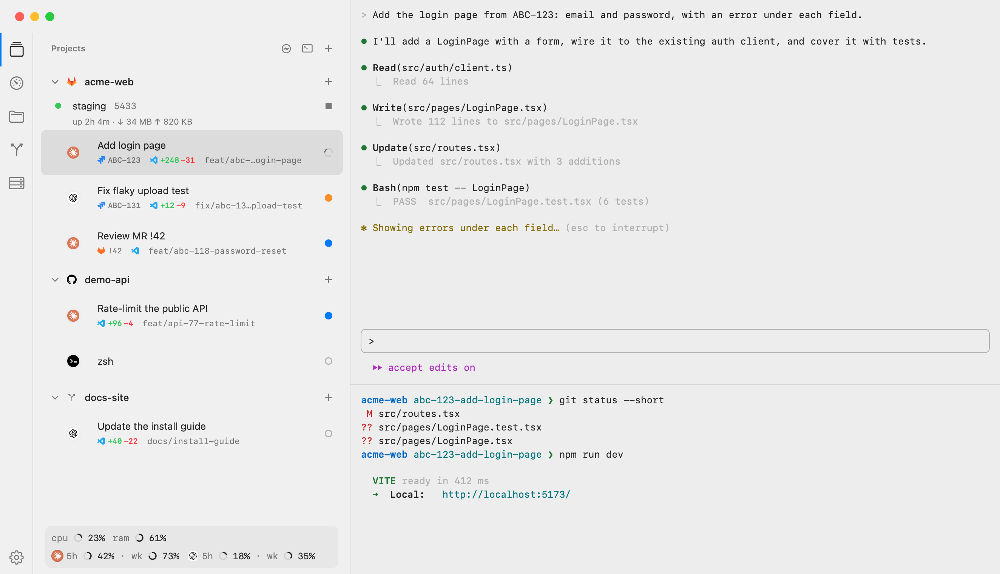
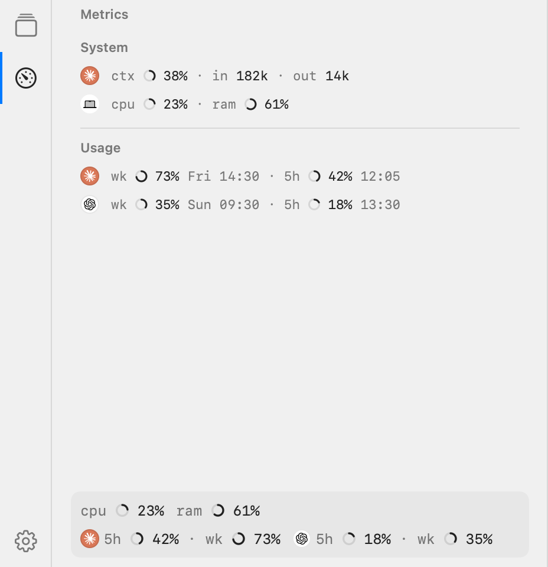
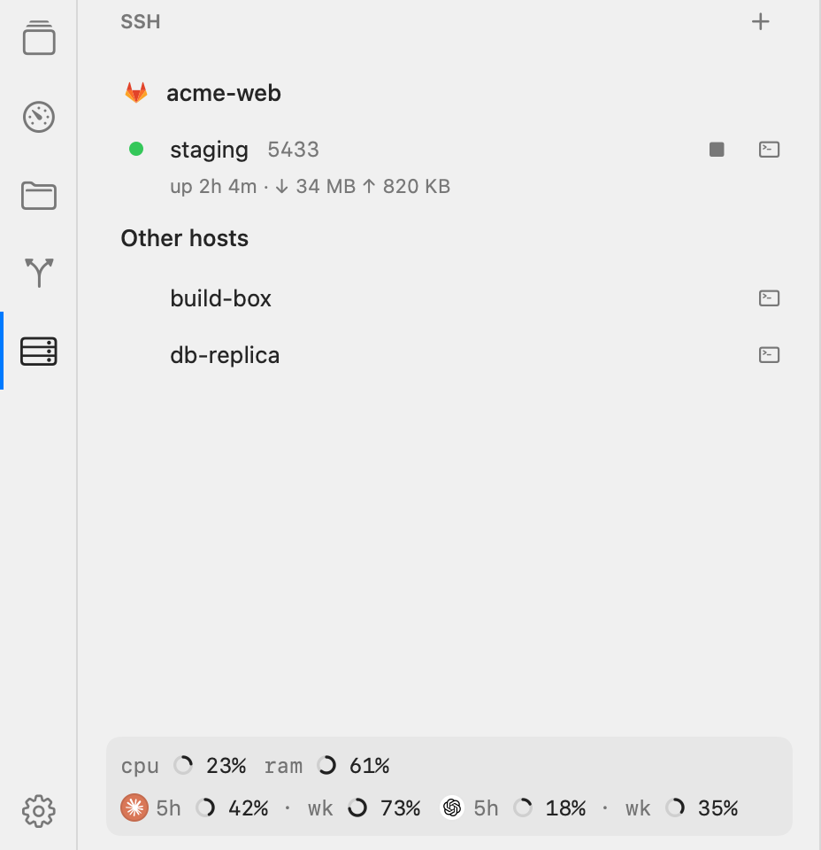
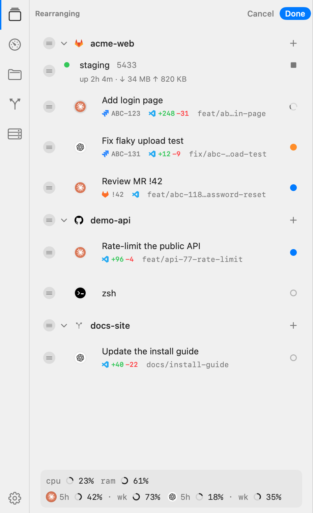
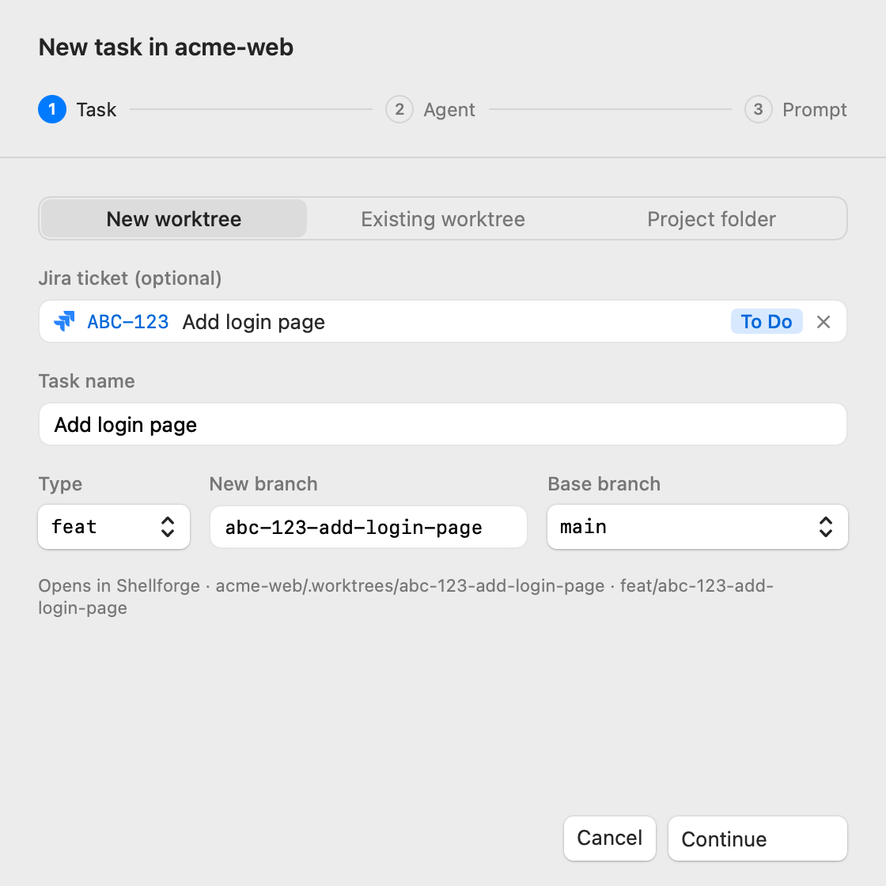

# Shellforge

### iTerm2 with a sidebar for projects, tasks and coding agents

Shellforge is a fork of [iTerm2](https://iterm2.com) that puts [AiTerm](https://github.com/dhondtlaurens/aiterm)'s
sidebar inside every terminal window:

- **Projects → tasks → tabs.** A task is a git worktree with an agent (Claude Code, Codex, Grok,
  PI, a ready-made one such as Gemini CLI or Aider, or your own) running in its tab; a review is
  one for a merge request.
- **Live status** from the agents' own hooks, or guessed from the terminal for an agent without them: working, waiting on you, done.
- **Jira, GitLab and GitHub:** tickets in New Task, merge requests in New Review, `+n −m` on every
  task.
- **SSH tunnels** per project, started and stopped from the sidebar, and a project's SSH host
  beside its agent.
- **Usage** of Claude Code's and Codex's plans in the metrics strip and the Metrics panel, and
  **Backpack Mode** for a Mac that keeps working with its lid closed.
- **At home on macOS 26:** a floating glass sidebar that follows light and dark, and an optional
  switch to match the terminal's colours to Shellforge.

Everything iTerm2 does still works as it does in iTerm2.

Shellforge follows iTerm2: we merge upstream iTerm2 into Shellforge whenever it is needed for a
security fix or a new feature, so a fix in iTerm2 reaches Shellforge too. Shellforge's own code is
kept apart in `Shellforge/` so these merges stay small.

## A look

<!-- Rendered from code with invented demo data, never from a real app: run
     Shellforge/scripts/render-screenshots.sh after a UI change and commit the PNGs. -->

<picture>
  <source media="(prefers-color-scheme: dark)" srcset="Shellforge/docs/images/window-dark.png">
  <source media="(prefers-color-scheme: light)" srcset="Shellforge/docs/images/window-light.png">
  
</picture>

<table>
  <tr>
    <th>Metrics</th>
    <th>SSH</th>
  </tr>
  <tr>
    <td valign="top">
<picture>
  <source media="(prefers-color-scheme: dark)" srcset="Shellforge/docs/images/metrics-dark.png">
  <source media="(prefers-color-scheme: light)" srcset="Shellforge/docs/images/metrics-light.png">
  
</picture>
    </td>
    <td valign="top">
<picture>
  <source media="(prefers-color-scheme: dark)" srcset="Shellforge/docs/images/ssh-dark.png">
  <source media="(prefers-color-scheme: light)" srcset="Shellforge/docs/images/ssh-light.png">
  
</picture>
    </td>
  </tr>
  <tr>
    <th>Rearrange</th>
    <th>New Task</th>
  </tr>
  <tr>
    <td valign="top">
<picture>
  <source media="(prefers-color-scheme: dark)" srcset="Shellforge/docs/images/rearrange-dark.png">
  <source media="(prefers-color-scheme: light)" srcset="Shellforge/docs/images/rearrange-light.png">
  
</picture>
    </td>
    <td valign="top">
<picture>
  <source media="(prefers-color-scheme: dark)" srcset="Shellforge/docs/images/new-task-dark.png">
  <source media="(prefers-color-scheme: light)" srcset="Shellforge/docs/images/new-task-light.png">
  
</picture>
    </td>
  </tr>
</table>

## Get it

**Requirements:** a Mac with Apple silicon on macOS 13 or newer, and Python 3.11 or newer.

Download the latest `Shellforge-<version>.dmg` from
[Releases](https://github.com/NathanGel/shellforge/releases/latest) and drag Shellforge to
Applications. The app is signed but not notarized by Apple, so macOS refuses to open it the first
time. Either:

- right-click Shellforge in Applications, choose **Open**, then **Open** again; or
- run `xattr -dr com.apple.quarantine /Applications/Shellforge.app` once.

After that it opens like any other app, and updates itself from **Shellforge › Check for
Updates…**. The [setup guide](SETUP.md) covers connecting Jira, GitLab and GitHub, agent hooks,
and moving over from AiTerm.

## Docs

- [SETUP.md](SETUP.md): installing, connecting Jira, GitLab and GitHub, agent hooks, coming from
  AiTerm
- [FEATURES.md](FEATURES.md): every feature and how to reach it, and
  [the keyboard](Shellforge/docs/keyboard.md)
- [CHANGELOG.md](CHANGELOG.md): what changed in each version
- [CONTRIBUTING.md](CONTRIBUTING.md): asking for a change
- [The code](Shellforge/README.md): Shellforge's own code lives in `Shellforge/`, apart from iTerm2's
- [Changes to iTerm2's own files](Shellforge/docs/upstream-hook-points.md)
- [Releasing](Shellforge/docs/releasing.md)

## Building

    Shellforge/scripts/make-app.sh      # → build/Shellforge.app

Xcode 27 and swiftly's Swift 6.4. Tests: `Shellforge/scripts/swift.sh test --package-path Shellforge`.
Day-to-day builds and dev runs are in [Releasing](Shellforge/docs/releasing.md#development-builds).

## Contributing

Shellforge takes **change requests, not pull requests**: open a
[change request or bug report](https://github.com/NathanGel/shellforge/issues/new/choose) on
GitHub. Pull requests are closed without review. [CONTRIBUTING.md](CONTRIBUTING.md) has the details.

## Credits and license

Shellforge is built on [iTerm2](https://github.com/gnachman/iTerm2) by George Nachman and its
contributors (iTerm2's own readme is [README-iTerm2.md](README-iTerm2.md)), and ports
[AiTerm](https://github.com/dhondtlaurens/aiterm) by Laurens D'Hondt. It is free software: iTerm2's
code is under the GNU GPL version 2 or later ([LICENSE](LICENSE)), and Shellforge's own code and
the app as a whole are under the GNU GPL version 3 ([Shellforge/LICENSE](Shellforge/LICENSE)).
Shellforge is not affiliated with or endorsed by the iTerm2 project.
